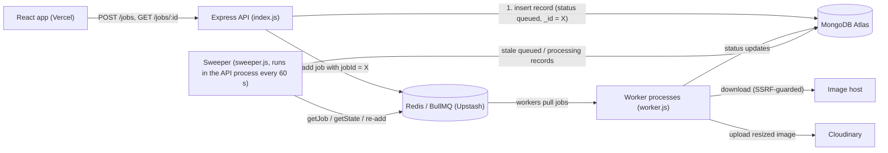

# Distributed Job Queue System

An asynchronous image-processing pipeline. An Express API accepts resize jobs, records each one in MongoDB, and hands it to a BullMQ queue on Redis. Separate worker processes take jobs from the queue, download and resize the image with sharp, and upload the result to Cloudinary. A React app submits jobs and shows their progress.

The focus is **correctness under failure**:
- a job record is never stranded in `queued`, even if Redis is down at submit time or a worker dies mid-job;
- transient errors are retried and permanent ones fail fast;
- workers refuse to fetch internal network addresses.

**Live demo:** https://distributed-job-queue-rho.vercel.app. The API runs on Render's free tier, so the first request after an idle period can take up to a minute while it wakes up.

---

## Features

- **Two ways to submit:** an image URL (`POST /jobs`), or a file upload (`POST /jobs/upload`, stored on Cloudinary first, then processed the same way).
- **Live status:** each job moves `queued → processing → completed | failed`. The UI polls unfinished jobs, and a paginated history can be filtered by status (`GET /jobs`).
- **Reliable hand-off (outbox pattern):** the job record is written to MongoDB *before* the job is queued, using the same id in both. If queuing fails, a background sweeper re-delivers the job.
- **Reconciliation:** the sweeper also repairs records whose status update was lost (for example when a worker crashed). It copies the job's real final state from BullMQ.
- **Retries with exponential backoff:** 3 attempts, 2 s then 4 s apart. Permanent errors (404, not an image, corrupt image, invalid input) fail immediately. A job is marked `failed` only after its last attempt.
- **Input safety:**
  - zod validation in the API *and* the worker;
  - an SSRF guard that only connects to public addresses, checked at connect time and on every redirect;
  - a 15 MB download cap and a 40-megapixel decode cap.
- **User-safe errors:** every API error is JSON with a readable `message`. Job failure messages are written for users, and internal details only go to logs. The UI explains network failures, a sleeping server and validation problems.
- **Operations:**
  - config from environment variables, failing fast if one is missing;
  - graceful worker shutdown on `SIGTERM`;
  - MongoDB indexes, with a loud log if one can't be built;
  - a `/health` endpoint.

## Architecture



**Where the truth lives.** MongoDB decides *that a job exists*: the record is written first. BullMQ decides *what happened to it*: the reconciler copies BullMQ's final state into MongoDB when they disagree.

**Delivery guarantee.** At-least-once delivery, with idempotent effects:
- A job can run twice (a retry, or a worker dying after the upload but before BullMQ records completion).
- A duplicate `add()` with the same `jobId` is ignored by BullMQ.
- A rerun overwrites the same Cloudinary asset (`public_id: resized-<jobId>`).
- Status writes use conditional updates, so a final state is never overwritten.

### Job lifecycle

1. `POST /jobs` validates the body (`validation.js`). Invalid input gets a 400 and nothing is written.
2. `enqueueJob()` inserts the MongoDB record (`queued`) with a fresh ObjectId, then calls `queue.add(..., { jobId })` with the same id. If Redis is unavailable, the API still answers `202 Accepted`, and the sweeper delivers the job later.
3. A worker takes the job and sets `processing`. It downloads the image through `safe-fetch.js`, resizes it with sharp, uploads it to Cloudinary, and sets `completed` with the result URL.
4. On an error, `worker.js` decides between retrying (network errors, 5xx, 408, 429) and failing immediately (`UnrecoverableError`). `handleFailed()` writes `failed` only on the final attempt.
5. Every 60 s the sweeper checks records that have been `queued` or `processing` for more than 2 minutes, asks BullMQ about each one, and either syncs the final state, re-adds a missing job, or leaves a job that is still running alone.

## Tech stack

| Layer | Technology |
|---|---|
| API | Node.js, Express 5, zod, multer |
| Queue | BullMQ on Redis (Upstash in production) |
| Database | MongoDB Atlas via Mongoose |
| Image processing | sharp (libvips) |
| Object storage | Cloudinary |
| Frontend | React 19 + Vite |
| Tests | Vitest (unit tests with fakes, plus integration tests against a real Redis) |
| CI | GitHub Actions |
| Hosting | Render (API and worker as separate services), Vercel (frontend) |

## Project structure

```
index.js          Express API: routes, enqueueJob(), error handling, starts the sweeper
worker.js         Worker: processJob(), retry/permanent-error rules, handleFailed(), graceful shutdown
sweeper.js        Outbox re-delivery + reconciliation against BullMQ
safe-fetch.js     SSRF-guarded image download (connect-time IP check, manual redirects, size cap)
validation.js     zod schemas shared by the API and the worker
config.js         Environment parsing (Redis connection, worker concurrency)
models.js         Mongoose Job schema and indexes
scripts/          check-job-ids.js: read-only duplicate-id check for the unique index
bench/            Load-test harness, results (RESULTS.md) and raw data
test/             Unit tests; test/integration/ runs against a real Redis
frontend/         React app; src/api.js handles all requests and error messages
```

## API

All responses are JSON. Errors always have a `message` written for the user. Validation errors also include `errors: [{ path, message }]`.

| Method and path | Purpose | Responses |
|---|---|---|
| `POST /jobs` | Submit a job by URL. Body: `{ "type": "resize-image", "payload": { "imageUrl": "https://…", "width": 300, "height": 300 } }`. `width`/`height` are integers 1–4000 (default 300). | `202 { jobId, mongoId }`, `400` invalid input |
| `POST /jobs/upload` | Submit an image file: multipart field `image` (max 10 MB), optional `width`, `height` | `202`, `400`, `413` too large |
| `GET /jobs/:jobId` | Status of one job: `status`, plus `result: { imageUrl, sizeKB }` or `error` | `200`, `404` |
| `GET /jobs?page=1&limit=20&status=failed` | Paginated history, newest first, optional status filter (`limit` max 100) | `200 { jobs, pagination }`, `400` |
| `GET /health` | Liveness check (does not touch MongoDB or Redis) | `200 { status: "ok" }` |

## Running locally

Requirements: Node.js 22 or 24, a Redis server, a MongoDB database, and a Cloudinary account.

```bash
npm install
cp .env.example .env        # then fill in the values (see below)
node index.js               # API on http://localhost:3000
node worker.js              # a worker; start more in other terminals to scale out

cd frontend
npm install
VITE_API_URL=http://localhost:3000 npm run dev
```

For a local Redis without TLS, set `REDIS_HOST=localhost` and `REDIS_TLS=false`.

### Environment variables

| Variable | Used by | Required | Notes |
|---|---|---|---|
| `MONGO_URI` | API, worker | yes | MongoDB connection string |
| `REDIS_HOST` | API, worker | yes | The process refuses to start without it (no silent `localhost` fallback) |
| `REDIS_PORT` | API, worker | no | Default `6379` |
| `REDIS_PASSWORD` | API, worker | for Upstash | |
| `REDIS_TLS` | API, worker | no | Default `true` (Upstash requires TLS). `false` only for a local Redis |
| `CLOUDINARY_CLOUD_NAME`, `CLOUDINARY_API_KEY`, `CLOUDINARY_API_SECRET` | API, worker | yes | The API uploads files; the worker uploads results |
| `WORKER_CONCURRENCY` | worker | no | Jobs one worker process runs at once. Default `2` |
| `PORT` | API, worker | no | API default `3000`; the worker serves a small health listener (default `3001`) because Render web services must bind a port |
| `VITE_API_URL` | frontend build | no | API base URL. Defaults to the deployed Render API |

`.env.example` lists them all with placeholders. Never commit a real `.env`.

## Testing

```bash
npm test                    # unit tests (backend + frontend helpers), no services needed
INTEGRATION_REDIS_HOST=127.0.0.1 npm run test:integration   # needs a Redis server; uses a throwaway queue
cd frontend && npm run lint && npm run build
```

- **Unit tests** replace MongoDB, BullMQ and Cloudinary with in-memory fakes. They cover the enqueue ordering (including a deterministic reproduction of the original race), the sweeper and reconciler, retry rules, validation, the SSRF guard (with a real local HTTP server), API error responses, config parsing and the frontend's error messages.
- **Integration tests** use a real Redis and BullMQ to check what the design relies on:
  - a duplicate `jobId` is ignored;
  - `failed` is written once, after the last attempt;
  - permanent errors are not retried;
  - the reconciler sees real job states.

  The image download, Cloudinary and MongoDB are still stubbed in these tests.

## CI/CD

`.github/workflows/ci.yml` runs on every push and pull request:

| Job | What it checks |
|---|---|
| Backend tests | `npm ci` and `npm test` on Node 22 and 24 |
| Integration tests | `npm run test:integration` against a `redis:7` service container |
| Frontend | `npm ci`, `npm run lint`, `npm run build` in `frontend/` |
| Dependency audit | `npm audit --omit=dev --audit-level=high` for the backend and the frontend |

This workflow does not deploy. Deployment uses the hosting platforms' GitHub integrations: Render for the API and worker, Vercel for the frontend. Those platforms do not wait for this workflow to pass, so check that CI is green on a branch before merging into `main`.

**Before deploying a change that touches config:** set every required variable on **both** Render services (API and worker). In particular, `REDIS_HOST` is no longer hard-coded.

**After a deploy:** check that `GET /health` returns `{"status":"ok"}`, submit one job from the live UI, and look for `Job indexes are in place` in the API logs. If the logs show `Could not build Job indexes`, run `node scripts/check-job-ids.js` with the production `MONGO_URI` to list the duplicate ids. It only reads.

## Load testing

`bench/run.js` measures throughput and latency with 1, 2 and 4 worker processes, against a real Redis and the real `processJob()`. The download, Cloudinary and MongoDB writes are stubbed. Full setup, results, interpretation and limitations are in **[bench/RESULTS.md](bench/RESULTS.md)**.

Summary of the **local benchmark** (2-vCPU VM, burst of 200 jobs, median of 3 runs, 0 failed jobs in 4,800):

| Worker processes | CPU-bound resize (jobs/s) | I/O-heavy, 250 ms simulated download + upload (jobs/s) |
|---|---|---|
| 1 | 43.7 | 1.91 |
| 2 | 81.4 (1.86×) | 3.80 (1.99×) |
| 4 | 82.6 (1.89×) | 7.54 (3.95×) |

CPU-bound work stops scaling at the number of cores. I/O-bound work scales almost linearly. A single process with `WORKER_CONCURRENCY=4` matched four processes on the I/O workload, using about a quarter of the memory.

```bash
npm run bench               # requires redis-server on PATH; starts and FLUSHES its own instance on port 6390
```

## Limitations

- **No authentication.** Anyone can submit jobs and read any job's status by id. Job ids are random ObjectIds, not sequential, but they aren't secrets.
- **Polling, not push.** The UI polls every 2 s. Server-Sent Events or WebSockets would cut requests.
- **The sweeper loads all stale records at once.** That's fine at this scale; it would need batching for a large backlog.
- **The load test is local and partly stubbed** (see bench/RESULTS.md). There are no production performance figures.
- **The API process has no graceful shutdown** (the worker does). Backoff has no jitter.
- **Records created before ids were ObjectIds may share an id**, which would block the unique index. Use `scripts/check-job-ids.js` to check.
